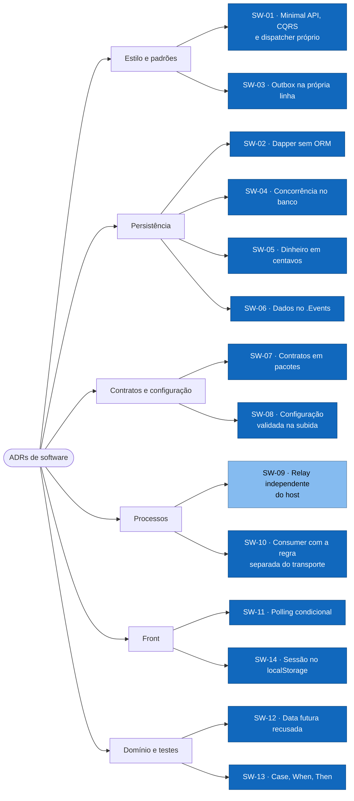

# ADRs de software

Decisões sobre frameworks, bibliotecas, padrões de projeto, persistência e concorrência
dentro do aplicativo. As decisões macro (nuvem, integração, dados entre sistemas, segurança,
fornecedor) estão nos [ADRs de solução](../../solucao/03-adrs/README.md).

Todos foram registrados em 07/10/2026, a partir do código no commit `45bcd17`, do
[README](../../../../README.md) e do [documento de arquitetura](<../../../Arquitetura dos Lançamentos Diários.md>).
As decisões já tinham sido tomadas e implementadas; estes registros dizem o porquê, o que
foi descartado e quando vale revisitar.

## Visão geral

As 14 decisões por tema. A central é a SW-03, o outbox na própria linha: dela decorrem a concorrência no banco (SW-04) e a recusa de data futura (SW-12). Azul: aceita; azul-claro: aceita, ainda não executada no GCP.

## Formato

Cada ADR tem status, contexto, decisão, alternativas, consequências, onde está no código e
o gatilho para revisitar. Status possíveis:

| Status | Significa |
|---|---|
| Aceita | Decidida e implementada no código |
| Aceita, não executada no GCP | Implementada, mas ainda não rodou no ambiente-alvo |
| Proposta | Documentada, sem implementação |
| Substituída | Trocada por outra ADR, indicada no texto |

## Índice

| ADR | Decisão | Status |
|---|---|---|
| [ADR-SW-01](ADR-SW-01-minimal-api-cqrs-dispatcher-proprio.md) | Minimal API com CQRS e dispatcher próprio, sem MediatR | Aceita |
| [ADR-SW-02](ADR-SW-02-dapper-sem-orm.md) | Dapper com SQL explícito, sem EF Core; esquema idempotente na subida | Aceita |
| [ADR-SW-03](ADR-SW-03-outbox-na-propria-linha.md) | Estágio na própria linha como outbox, com transições condicionais | Aceita |
| [ADR-SW-04](ADR-SW-04-concorrencia-no-banco.md) | Concorrência resolvida no banco: sequência, reserva e saldo | Aceita |
| [ADR-SW-05](ADR-SW-05-dinheiro-em-centavos.md) | Dinheiro em centavos (`bigint`), sinal pelo tipo | Aceita |
| [ADR-SW-06](ADR-SW-06-camada-de-dados-compartilhada-no-events.md) | Camada de dados e contrato do evento compartilhados no `.Events` | Aceita |
| [ADR-SW-07](ADR-SW-07-contratos-em-pacotes.md) | Contratos em pacotes `.Messages` e `.Common`, sem ASP.NET Core no `.Common` | Aceita |
| [ADR-SW-08](ADR-SW-08-configuracao-sem-padrao-no-codigo.md) | Configuração sem padrão no código, validada na subida | Aceita |
| [ADR-SW-09](ADR-SW-09-relay-independente-do-host.md) | Ciclo do relay independente do host: loop local, ciclo único no Job | Aceita, não executada no GCP |
| [ADR-SW-10](ADR-SW-10-consumer-com-regra-isolada-do-transporte.md) | Consumer com a regra separada do transporte | Aceita |
| [ADR-SW-11](ADR-SW-11-polling-condicional-no-front.md) | Polling condicional no front, formatação pt-BR no servidor | Aceita |
| [ADR-SW-12](ADR-SW-12-data-futura-recusada.md) | Data futura recusada, não agendada | Aceita |
| [ADR-SW-13](ADR-SW-13-testes-case-when-then.md) | Testes de unidade Case/When/Then com xUnit, Moq, NBuilder e FluentAssertions | Aceita |
| [ADR-SW-14](ADR-SW-14-sessao-no-localstorage.md) | Sessão do front no `localStorage`, uma renovação por vez | Aceita |

## Como propor uma nova

1. Copie um ADR existente, com o próximo número.
2. Status **Proposta**. Abra o PR com o ADR antes do código, ou junto.
3. Ao aceitar, mude o status e atualize este índice.
4. Um ADR aceito não é editado para mudar a decisão: escreva outro e marque o antigo como
   **Substituída**.
