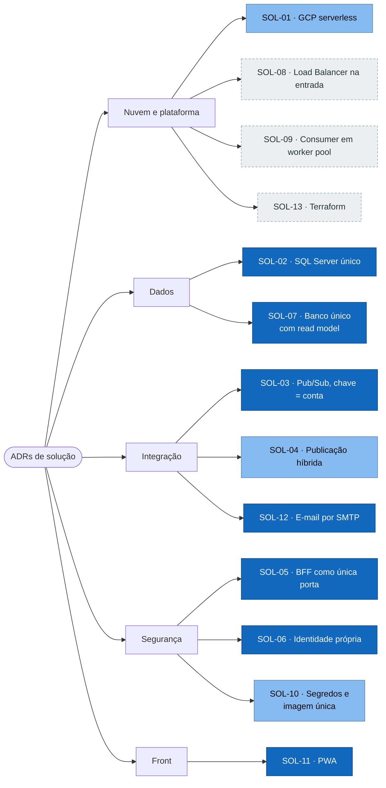

# ADRs de solução

Decisões macro: nuvem, integração, dados entre processos, segurança e fornecedores. As
decisões internas do aplicativo estão nos [ADRs de software](../../software/03-adrs/README.md).

Registrados em 07/10/2026, a partir do código no commit `45bcd17`, do
[README](../../../../README.md), do [documento de arquitetura](<../../../Arquitetura dos Lançamentos Diários.md>)
e do [script de deploy do relay](../../../../deploy/events-cloud-run-job.sh). Onde a decisão é
proposta deste conjunto de documentos, o status diz.

| Status | Significa |
|---|---|
| Aceita | Decidida e refletida no código ou nos scripts |
| Aceita, não executada | Decidida, com código ou script prontos, mas nada foi implantado |
| Proposta | Recomendação, sem implementação |

## Visão geral

As 13 decisões por tema. Azul: aceita; azul-claro: aceita, ainda não executada no GCP; tracejado: proposta.

## Índice

| ADR | Decisão | Status |
|---|---|---|
| [ADR-SOL-01](ADR-SOL-01-gcp-serverless.md) | GCP com serviços gerenciados e serverless, em `southamerica-east1` | Aceita, não executada |
| [ADR-SOL-02](ADR-SOL-02-sql-server-como-motor-unico.md) | SQL Server como motor único: container no local, Cloud SQL no GCP | Aceita |
| [ADR-SOL-03](ADR-SOL-03-consolidacao-assincrona-pubsub.md) | Consolidação assíncrona por Pub/Sub, com ordering key = conta | Aceita |
| [ADR-SOL-04](ADR-SOL-04-publicacao-hibrida.md) | Publicação imediata na WebApi e relay por Cloud Run Job a cada minuto | Aceita, não executada no GCP |
| [ADR-SOL-05](ADR-SOL-05-bff-como-unica-porta.md) | BFF como única porta do front; WebApi fora da internet | Aceita |
| [ADR-SOL-06](ADR-SOL-06-identidade-propria-jwt.md) | Identidade própria: JWT HS256 emitido pela WebApi, renovação opaca, Google federado | Aceita |
| [ADR-SOL-07](ADR-SOL-07-banco-unico-com-read-model.md) | Um banco para os processos do serviço, com o read model no mesmo banco | Aceita |
| [ADR-SOL-08](ADR-SOL-08-load-balancer-como-entrada.md) | Load Balancer HTTPS externo como entrada única, com Cloud Armor | Proposta |
| [ADR-SOL-09](ADR-SOL-09-consumer-em-worker-pool.md) | Consumer em worker pool do Cloud Run, com pull | Proposta |
| [ADR-SOL-10](ADR-SOL-10-segredos-e-imagem-unica.md) | Segredos no Secret Manager e uma imagem para todos os ambientes | Aceita para o relay; proposta para os demais |
| [ADR-SOL-11](ADR-SOL-11-pwa.md) | PWA instalável em vez de app de loja | Aceita |
| [ADR-SOL-12](ADR-SOL-12-email-por-smtp.md) | E-mail transacional por SMTP genérico | Aceita; provedor a definir |
| [ADR-SOL-13](ADR-SOL-13-terraform.md) | Infraestrutura como código com Terraform | Proposta |
